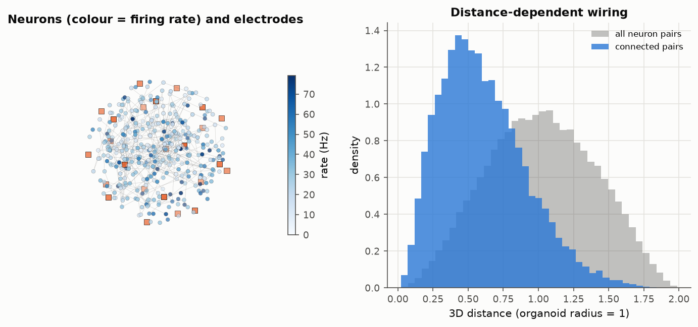
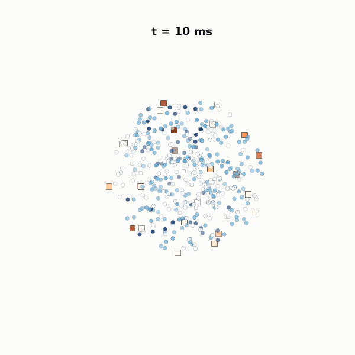
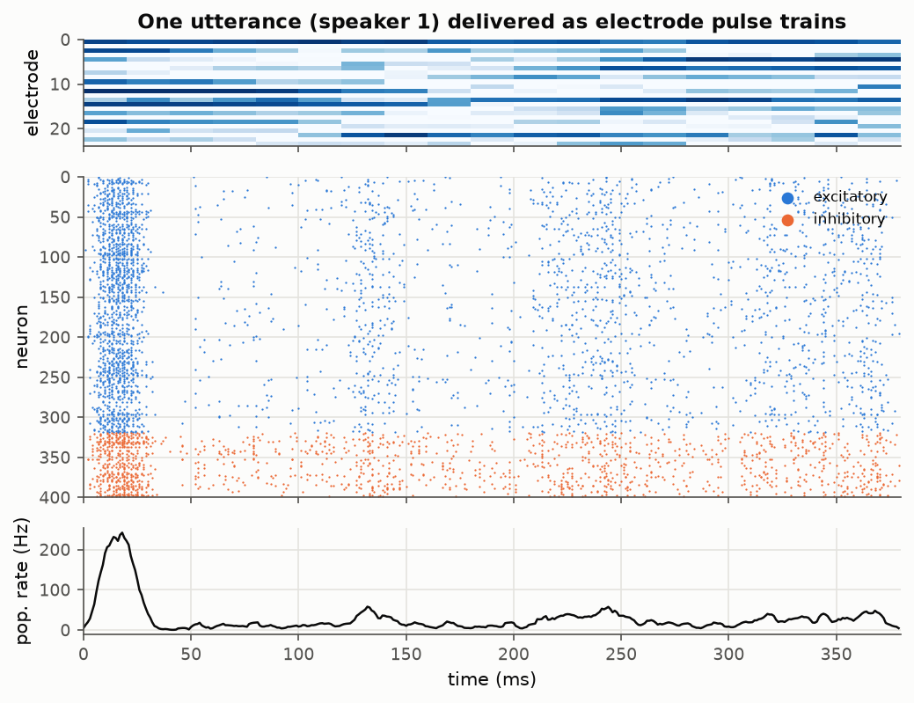
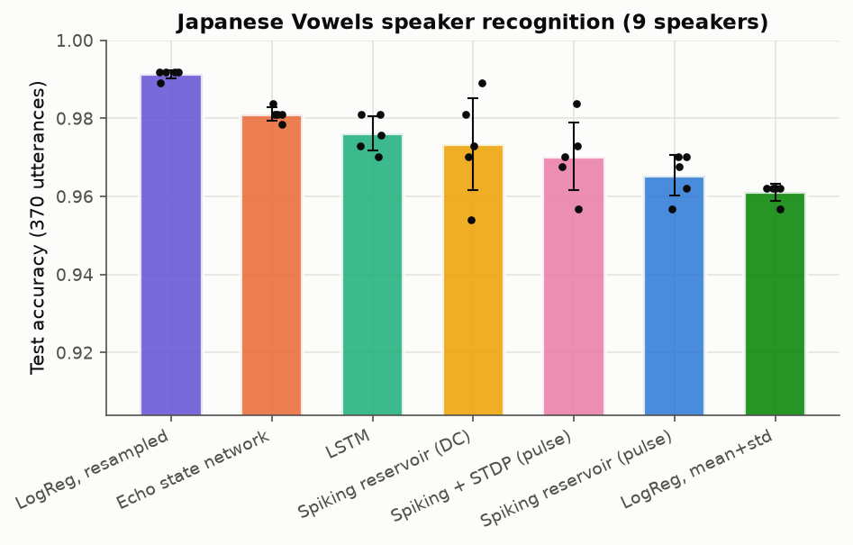
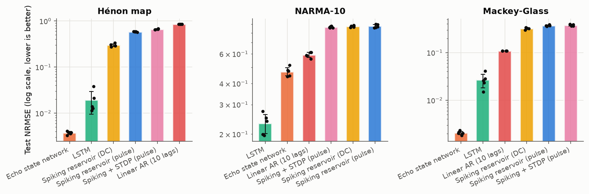
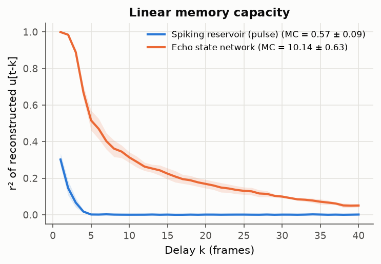
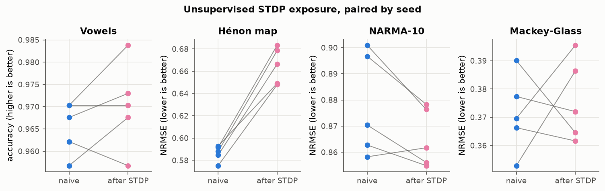
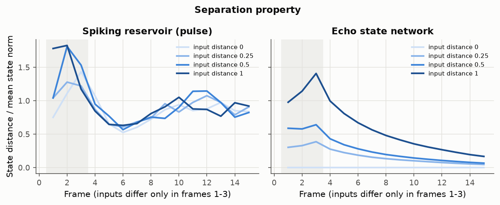
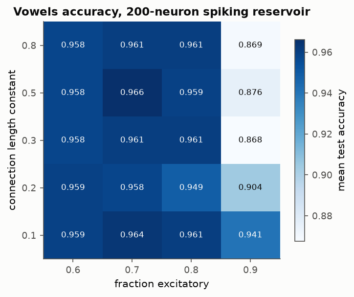

# organoid-reservoir

[](https://github.com/veermshah/organoid-reservoir/actions/workflows/ci.yml)
[](LICENSE)


Brainoware-style reservoir computing on a simulated, organoid-like spiking network.
I wire 400 Izhikevich neurons inside a sphere, stimulate them through a virtual
electrode array, train only a linear readout, and compare the result against an
echo state network, an LSTM and plain linear models.

| | | |
|---|---|---|
|  |  |  |
|  |  |  |
|  |  |  |

The full write-up, with every figure and an honest discussion, is in
**[report.md](report.md)**.

## Background

In 2023 Cai et al. grew a human brain organoid on a high-density multi-electrode
array and used it as the reservoir in a reservoir-computing system they called
Brainoware. Audio clips and chaotic time series were converted into patterns of
electrical stimulation, the organoid's evoked activity was recorded, and only a
linear readout was trained. They reported speaker recognition on Japanese vowels
and Hénon-map prediction, and that unsupervised training (repeated stimulation
without labels) improved accuracy.

Reservoir computing itself goes back to echo state networks (Jaeger 2001) and
liquid state machines (Maass, Natschläger & Markram 2002). The idea is that a
fixed, random, nonlinear dynamical system with fading memory projects inputs
into a high-dimensional space where a linear readout is enough. Any physical
system with the right properties can serve as the reservoir, and that is what
makes organoids attractive.

I wanted to see how much of Brainoware's behaviour a simulated organoid-like
network reproduces, and how it stacks up against conventional reservoirs when
everything else (encoding, readout, data splits) is held fixed.

## What's in here

- **Spiking reservoir** (`organoid_reservoir/reservoir.py`): vectorised NumPy
  Izhikevich network with 3D exponential distance-dependent wiring, 80/20 E/I
  split, background noise that produces spontaneous bursting, optional slow
  NMDA-like synapses, and pair-based STDP with homeostatic rescaling on E→E synapses.
  All inputs in a batch are simulated in parallel.
- **Virtual electrode array** (`encoding.py`): electrodes on the organoid surface
  with Gaussian coupling to nearby neurons; push-pull, multi-threshold encoding;
  Poisson pulse-train or DC stimulation.
- **Tasks**: Japanese Vowels speaker recognition (UCI, downloaded on demand), Hénon
  map, NARMA-10, Mackey-Glass and linear memory capacity.
- **Baselines**: echo state network, LSTM (PyTorch CPU), logistic regression on
  time-averaged and on resampled features, linear autoregression.
- **Ablations**: STDP exposure vs naive, reservoir size, pulse vs DC stimulation,
  background-noise level, and a hyperparameter grid (E/I ratio × connection length).
- **Diagnostics**: firing statistics, kernel quality and generalisation rank
  (Legenstein & Maass 2007), and the separation property.
- **Reproducibility**: YAML configs, and every results row is stamped with a config
  hash and git commit.

## Results

Mean ± std over 5 seeds, 400-neuron reservoirs (full table in [report.md](report.md)):

| Model | Vowels accuracy ↑ | Hénon NRMSE ↓ | NARMA-10 NRMSE ↓ | Mackey-Glass NRMSE ↓ | Memory capacity ↑ |
|---|---|---|---|---|---|
| Spiking reservoir (pulse) | 0.965 ± 0.006 | 0.586 ± 0.007 | 0.878 ± 0.020 | 0.371 ± 0.014 | 0.57 ± 0.09 |
| Spiking + STDP (pulse) | 0.970 ± 0.010 | 0.665 ± 0.016 | 0.865 ± 0.011 | 0.376 ± 0.015 | – |
| Spiking reservoir (DC) | 0.974 ± 0.013 | 0.299 ± 0.024 | 0.875 ± 0.011 | 0.322 ± 0.013 | – |
| Echo state network | 0.981 ± 0.002 | **0.0037** | 0.470 ± 0.030 | **0.0021** | **10.1 ± 0.6** |
| LSTM | 0.976 ± 0.005 | 0.019 ± 0.011 | **0.232 ± 0.033** | 0.027 ± 0.009 | – |
| LogReg, resampled features | **0.991 ± 0.001** | – | – | – | – |
| Linear AR (10 lags) | – | 0.854 | 0.592 ± 0.022 | 0.108 | – |

Short version: the simulated organoid works as a reservoir and gets within 1–2
points of the ESN on vowels, but it has almost no fading memory (memory capacity
≈ 0.6 vs 10 for the ESN), so it does badly on time series that need history. STDP
exposure moves vowels accuracy by about +0.5 points (inside seed noise), helps
NARMA-10 slightly and hurts Hénon. The diagnostics point to noise-dominated states
and short reverberation as the cause.

## Running it

Needs Python 3.11+ (I use 3.12).

```bash
make install            # venv + pip install -e ".[dev,lstm]"
make test               # pytest, no network needed
make reproduce          # every number and figure in report.md (~13 min on a laptop CPU)
```

Or directly:

```bash
python -m organoid_reservoir.run --task vowels          # vowels | henon | narma10 | mackey_glass
python -m organoid_reservoir.run --task all             # + timeseries, memory, sizes, diagnostics
python -m organoid_reservoir.run --task all --config configs/quick.yaml   # ~30 s smoke test
python -m organoid_reservoir.run --task henon --set reservoir.n_neurons=800 encoder.mode=current
python -m organoid_reservoir.sweep --config configs/sweep.yaml           # heatmap
```

Results go to `results/` (CSV, stamped with config hash and git commit) and
figures to `figures/`. The Japanese Vowels files are fetched from the UCI archive
into `data/raw/` on first use and checked against SHA-256 hashes. They are not
committed.

`notebooks/tour.ipynb` walks through building a reservoir, stimulating it, looking
at the spikes and training a readout. `make notebook` re-executes it.

## Project structure

```
organoid_reservoir/
  data.py          Japanese Vowels download/parsing, Hénon, NARMA-10, Mackey-Glass
  encoding.py      virtual electrode array and stimulation encoding
  reservoir.py     Izhikevich spiking reservoir with 3D wiring and STDP
  esn.py           echo state network baseline
  lstm.py          LSTM baselines (optional PyTorch)
  features.py      pooling of per-frame states, baseline features
  readout.py       ridge / logistic readouts and metrics
  experiments.py   per-seed task runners
  diagnostics.py   firing stats, kernel quality, generalisation rank, separation
  config.py        YAML config dataclasses, config hash, git stamp
  plotting.py      figures
  viz3d.py         3D figure and activity GIF
  run.py           main CLI
  sweep.py         hyperparameter grid CLI
configs/           default.yaml (report), quick.yaml (smoke test), sweep.yaml
tests/             pytest suite with a tiny bundled vowels fixture
results/           committed CSV summaries from the default run
figures/           committed figures
notebooks/         executed tour notebook
scripts/           notebook builder
```

## Limitations

- **This is a simulation, not living tissue.** The model leaves out cell-type
  diversity, development, glia, short-term plasticity, neuromodulation and the
  weeks of culture behind real organoid experiments. It shows what a generic
  organoid-like spiking network can do, not what an organoid can do.
- Network size (400 neurons) and simulation length are scaled down so the whole
  study runs on a laptop CPU in about 13 minutes.
- I tuned the encoder and weights by hand on the vowels task, so the spiking
  vowels numbers are a little optimistic. Task protocols are my own choices, not
  a replication of Brainoware's exact setup or dataset.
- The diagnostics and sweeps use fewer seeds (2–3) than the main table (5).

## Citation

If this is useful to you, see [CITATION.cff](CITATION.cff). The work it builds on:

- Cai, H. et al. (2023). Brain organoid reservoir computing for artificial
  intelligence. *Nature Electronics* 6, 1032–1039. doi:10.1038/s41928-023-01069-w
- Jaeger, H. (2001). The "echo state" approach to analysing and training recurrent
  neural networks. GMD Report 148.
- Jaeger, H. (2002). Short term memory in echo state networks. GMD Report 152.
- Maass, W., Natschläger, T. & Markram, H. (2002). Real-time computing without
  stable states. *Neural Computation* 14(11), 2531–2560.
- Legenstein, R. & Maass, W. (2007). Edge of chaos and prediction of computational
  performance for neural circuit models. *Neural Networks* 20(3), 323–334.
- Izhikevich, E. M. (2003). Simple model of spiking neurons. *IEEE Trans. Neural
  Networks* 14(6), 1569–1572.
- Kudo, M., Toyama, J. & Shimbo, M. (1999). Multidimensional curve classification
  using passing-through regions. *Pattern Recognition Letters* 20, 1103–1111.

## License

MIT, see [LICENSE](LICENSE).
