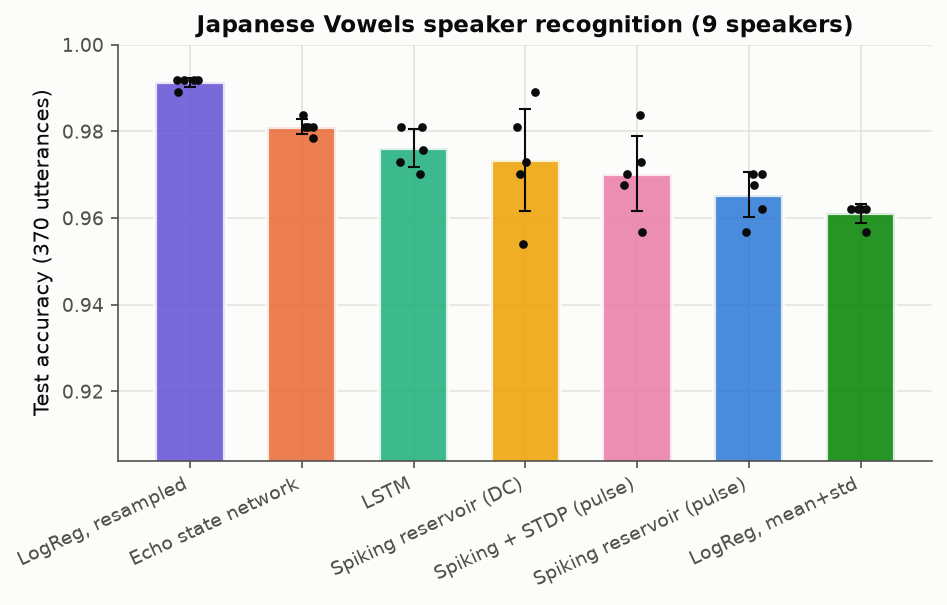
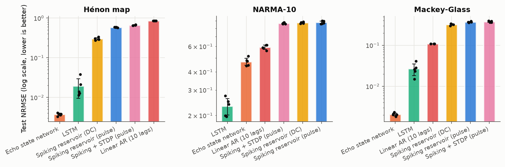
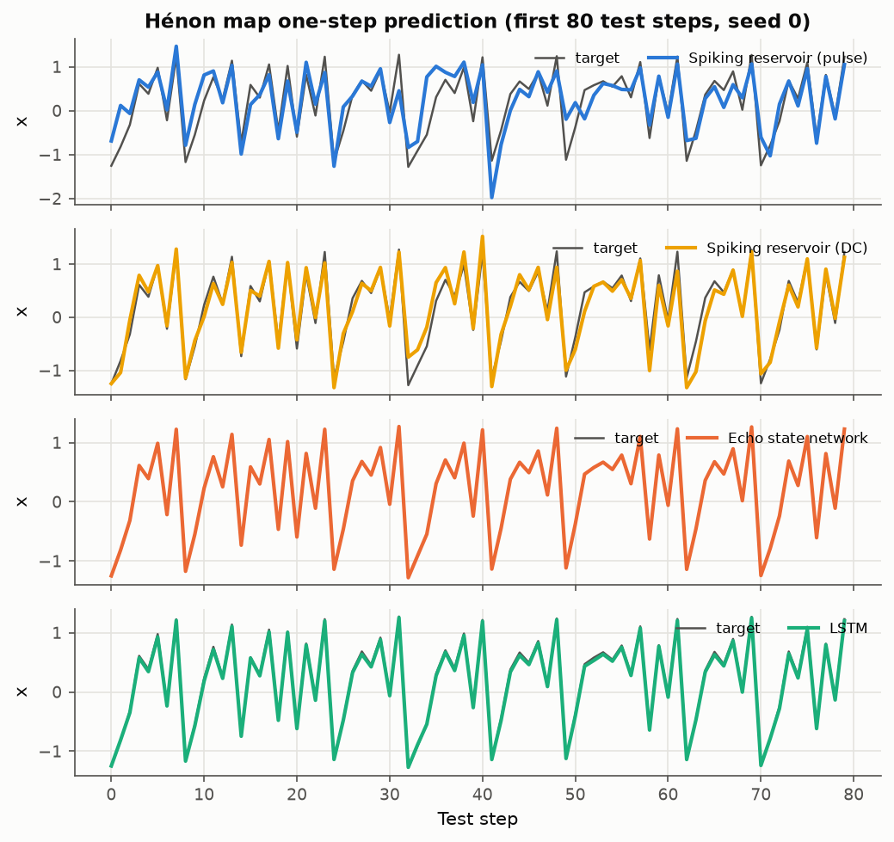
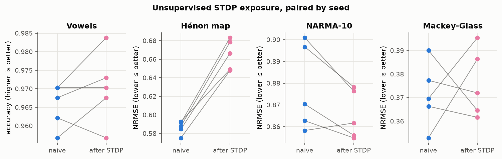
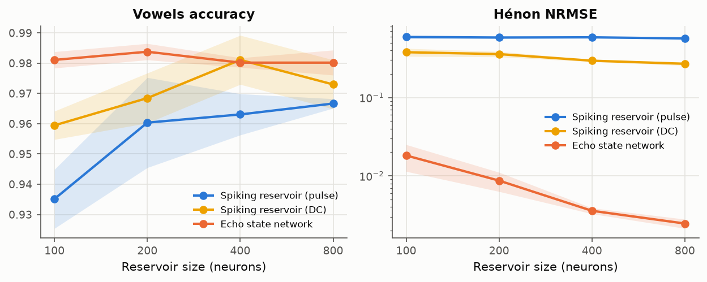
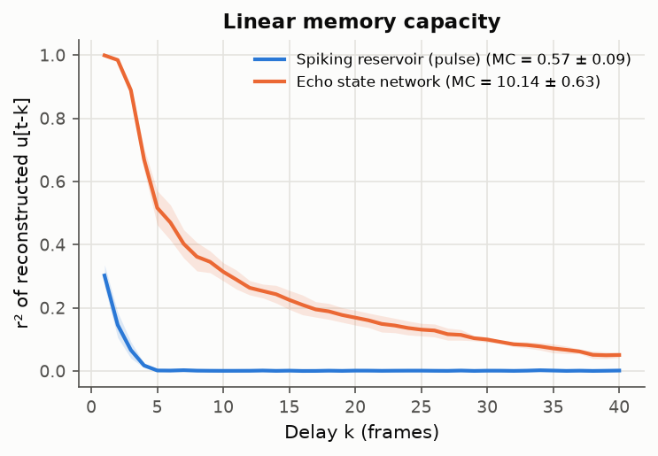
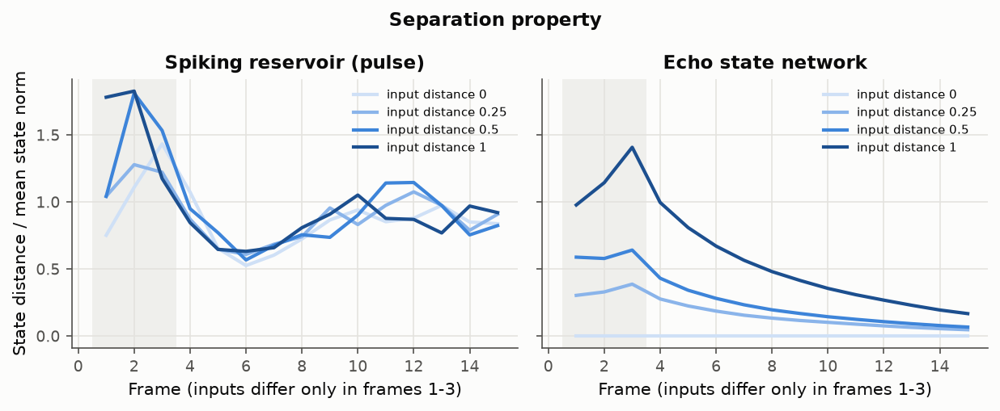
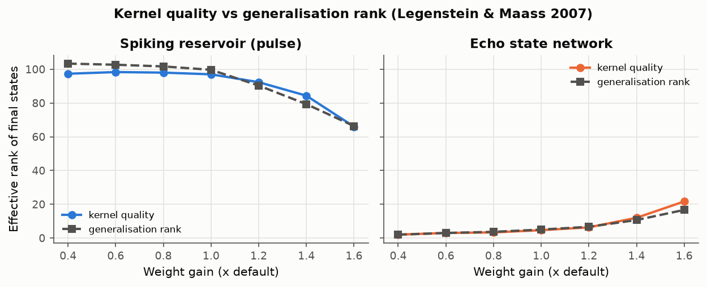
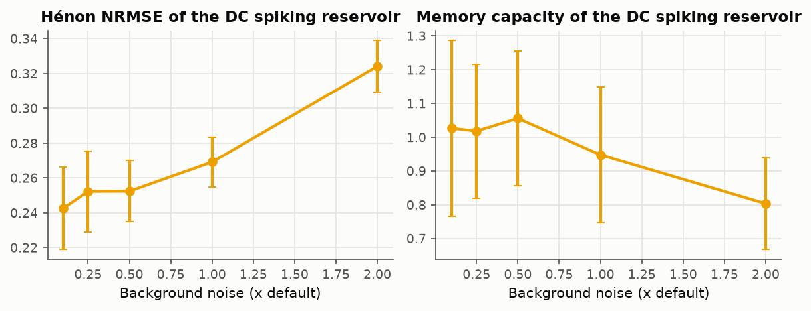
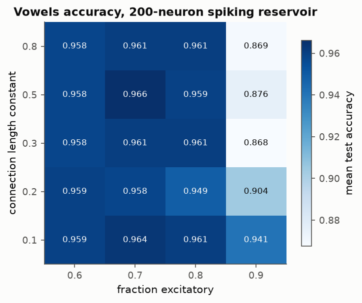

# Report: does a simulated organoid make a good reservoir?

Veer Shah, November 2026

All numbers below come from `make reproduce` (config `configs/default.yaml`, hash
`7b4f6f318259`, 5 seeds unless stated) and are stored in `results/`. Each CSV row
carries the config hash and the git commit that produced it.

## 1. Question

Cai et al. (2023) grew a brain organoid on a multi-electrode array, stimulated it
with encoded audio and chaotic time series, and trained only a linear readout on
the recorded activity ("Brainoware"). They reported that the organoid could tell
speakers apart and predict the Hénon map, and that unsupervised exposure to the
training stimuli made it better. That is reservoir computing (Jaeger 2001; Maass
et al. 2002) with living tissue as the reservoir.

I can't grow organoids, so I asked a narrower question: if I build a spiking
network with organoid-like properties (3D distance-dependent wiring, E/I balance,
noisy spontaneous bursting, STDP) and drive it through a virtual electrode array,
how does it compare with an ordinary echo state network and with non-reservoir
baselines on the same tasks? And what about its dynamics explains the result?

## 2. Method

**Reservoir.** N = 400 Izhikevich (2003) neurons placed uniformly in a unit
sphere. 80% are excitatory (regular-spiking/chattering mix), 20% inhibitory
(fast-spiking/low-threshold mix). Connection probability is
`p_ij ∝ exp(-d_ij / 0.3)`, scaled to a mean in-degree of 40. Synaptic currents decay
with τ = 5 ms, and every cell gets Gaussian background current, which produces
low-rate spontaneous activity (1–1.5 Hz E, 4–5 Hz I) with population bursts
(population-rate CV ≈ 1.0–1.9). The simulation is vectorised NumPy at dt = 1 ms,
with the whole batch of inputs simulated in parallel.

**Electrodes.** For vowels each input feature gets 2 electrodes (push-pull: one
for positive values, one for negative). Each scalar time series gets 8 electrodes
with staggered thresholds. Electrodes sit on the sphere surface and couple to
neurons with a Gaussian falloff (σ = 0.35). Electrode intensity in [0, 1]
becomes either Poisson pulse trains (up to 200 Hz, the default and closer to MEA
stimulation) or a DC current. Each input frame is held for 20 ms.

**Readout.** The state is an exponential spike trace (τ = 20 ms) sampled at the
end of each frame. For vowels, states are pooled over the utterance (mean plus
three temporal segments) and classified with logistic regression, with C chosen
by 5-fold CV on the training set. For time series, the readout is ridge
regression on [state, current input] with α chosen by leave-one-out CV on the
training span.

**STDP ablation.** Pair-based STDP on E→E synapses with homeostatic rescaling of
each neuron's total excitatory input. The network is exposed once to the training
inputs with plasticity on, frozen, and then the readout is trained. The "naive"
comparison uses the same seed and the same noise stream, so the only difference
is the weights.

**Baselines.** Echo state network (400 tanh units, spectral radius 0.9, leak 0.5,
same pooling and readout), a 64-unit LSTM (PyTorch CPU), logistic regression on
per-coefficient mean and std, logistic regression on utterances resampled to 8
frames, and a 10-lag linear autoregressive model for the time series.

**Tasks.**
- Japanese Vowels (Kudo et al. 1999; UCI): 9 speakers, 12 LPC cepstrum
  coefficients, 7–29 frames, official split of 270 train and 370 test.
- Hénon map (a = 1.4, b = 0.3): one-step prediction of x.
- NARMA-10 (Atiya & Parlos 2000).
- Mackey-Glass (τ = 17), sampled every 3 time units, one-step prediction.
- Linear memory capacity (Jaeger 2002): Σ_k r²(u[t−k], readout_k) for k = 1..40.

Time-series runs use 100 washout, 2000 train and 1000 test steps.

## 3. Results

### 3.1 Main comparison (mean ± std over 5 seeds)

| Model | Vowels accuracy ↑ | Hénon NRMSE ↓ | NARMA-10 NRMSE ↓ | Mackey-Glass NRMSE ↓ | Memory capacity ↑ |
|---|---|---|---|---|---|
| Spiking reservoir, pulse stimulation | 0.965 ± 0.006 | 0.586 ± 0.007 | 0.878 ± 0.020 | 0.371 ± 0.014 | 0.57 ± 0.09 |
| Spiking reservoir, pulse + STDP | 0.970 ± 0.010 | 0.665 ± 0.016 | 0.865 ± 0.011 | 0.376 ± 0.015 | – |
| Spiking reservoir, DC stimulation | 0.974 ± 0.013 | 0.299 ± 0.024 | 0.875 ± 0.011 | 0.322 ± 0.013 | – |
| Echo state network | 0.981 ± 0.002 | **0.0037 ± 0.0003** | 0.470 ± 0.030 | **0.0021 ± 0.0002** | **10.1 ± 0.6** |
| LSTM (64 units) | 0.976 ± 0.005 | 0.019 ± 0.011 | **0.232 ± 0.033** | 0.027 ± 0.009 | – |
| LogReg, mean + std features | 0.961 ± 0.002 | – | – | – | – |
| LogReg, resampled to 8 frames | **0.991 ± 0.001** | – | – | – | – |
| Linear AR, 10 lags | – | 0.854 | 0.592 ± 0.022 | 0.108 | – |

### 3.2 STDP exposure

Paired by seed, unsupervised STDP exposure:
- Vowels: +0.5 points on average (per-seed changes from −0.5 to +1.4 points; 3 of
  5 seeds improved, 1 unchanged, 1 worse). E→E weights moved by 15% (relative
  Frobenius norm).
- Hénon: worse for all 5 seeds (+0.08 NRMSE).
- NARMA-10: slightly better for 4 of 5 seeds (−0.012 NRMSE).
- Mackey-Glass: mixed, no net effect.

On the time series the network hears one long training sequence with no batch
averaging, so the weights change much more (≈100% relative change) and the
network drifts away from the regime the readout liked.

### 3.3 Reservoir size

Vowels accuracy of the pulse reservoir rises from 0.935 (N = 100) to 0.967
(N = 800). The DC reservoir peaks at 0.981 at N = 400. The ESN is flat at about
0.98 from N = 100. On Hénon the DC reservoir improves from 0.38 to 0.27 NRMSE
over the same range while the ESN goes from 0.018 to 0.0025. Larger spiking
networks help, but slowly.

### 3.4 Dynamics: why the spiking reservoir struggles on time series

The spiking reservoir's linear memory capacity is about 0.6, against 10 for the
ESN. Its state carries almost nothing about the input more than one frame
(20 ms) ago, and that alone explains most of the time-series results. Hénon needs
x[t−1] and NARMA-10 needs ten steps of history. Without memory, the best a
readout can do on Hénon is fit the instantaneous part 1 − 1.4x², which caps NRMSE
around 0.3. That is where the DC reservoir lands.

The separation plot shows the same thing from another angle. Two input streams
that differ only in their first three frames drive the ESN apart, and the
difference then decays smoothly over about ten frames. In the spiking reservoir,
two streams with *identical* inputs (distance 0) already differ by about as much
as the mean state norm because of the background noise, and a perturbation
stands out above that floor for only one or two frames.

Kernel quality and generalisation rank (Legenstein & Maass 2007) agree. For the
ESN, kernel quality exceeds generalisation rank once the gain is high enough. For
the spiking reservoir both ranks sit near the maximum (about 100 out of 120
streams) and track each other at every gain. Its states are high-dimensional, but
mostly because of noise, so different inputs and noisy copies of one input look
equally diverse.

Turning the background noise down helps a little (Hénon NRMSE 0.27 → 0.24 at
0.1× noise), but memory capacity stays near 1. Noise costs precision, but the
missing memory is structural: with 5 ms synapses, 20 ms frames and low
recurrent gain, activity doesn't reverberate long enough to carry the past. I
tried slow NMDA-like synapses and longer readout traces (config options
`reservoir.slow_frac` and `reservoir.trace_taus`). They raised memory capacity to
about 1.5–2 but cost precision, and no setting I tried got Hénon much below 0.2.

### 3.5 Hyperparameters

On a 200-neuron reservoir (2 seeds per cell), vowels accuracy is flat between
0.95 and 0.97 for excitatory fractions of 0.6–0.8 at any connection length
constant. At 90% excitatory the network loses inhibitory control, bursts, and
accuracy falls to 0.87–0.94. The default (0.8, λ = 0.3) is on the plateau.

## 4. Discussion

**Does the spiking reservoir help compared with an ESN?** Not on these tasks.
On vowels it gets within 1–2 points of the ESN and the LSTM, but a plain
logistic regression on resampled coefficients beats every reservoir (0.991).
Japanese Vowels is close to linearly separable once the sequence is resampled,
so it says little about reservoir quality. The time-series tasks actually need
memory, and there the spiking reservoir is one to two orders of magnitude worse
than the ESN. It also loses to a linear AR model on NARMA-10 and Mackey-Glass.

**Does that contradict Brainoware?** Not really. Cai et al. compared the organoid
with small ANNs and reported 78% accuracy on their own 240-clip, 8-speaker
version of the vowel task. Every baseline here does far better on the UCI split,
but the two setups aren't directly comparable. My reading of these results is
that the interesting part of an organoid reservoir is the physical substrate (low
power, self-organisation, plasticity) rather than raw accuracy. A biologically
flavoured spiking model reproduces the qualitative story: it works as a
reservoir, gets better with size, and STDP exposure can shift accuracy by a
point or so. It still doesn't beat a 25-year-old tanh network.

**STDP.** On vowels the average gain is small and inside seed-to-seed noise. On
NARMA-10 there is a small, consistent gain, and on Hénon a consistent loss. So
unsupervised plasticity isn't a free improvement. It moves the network to a
different regime that suits some tasks and not others. Brainoware's reported
unsupervised gain came from days of repeated stimulation of real tissue, which
this model doesn't try to reproduce.

**Pulse vs DC stimulation.** Poisson pulse trains are closer to how an MEA
stimulates tissue, but they add input noise. DC stimulation was better on every
task, and about twice as good on Hénon.

## 5. Limitations

- This is a simulation. Nothing here is living tissue, and the model leaves out
  most of what makes organoids interesting: cell diversity, development, glia,
  short-term plasticity, neuromodulation and weeks-long learning.
- I tuned the encoder and weight settings by hand in a few dozen vowels runs,
  using test accuracy as a guide, so the spiking vowels numbers are slightly
  optimistic. The baselines got less tuning than that.
- The task setups (feature pooling, frame length, train/test lengths) are my
  choices, not Brainoware's protocol, and the vowel dataset differs from theirs.
- Diagnostics use 3 seeds, the size sweep uses 3 and the hyperparameter sweep
  uses 2.
- The full reproduction takes about 13 minutes on an Apple-silicon laptop CPU.
  Most of that is the single-sequence STDP and LSTM runs on the time series.

## References

- Cai, H., Ao, Z., Tian, C., Wu, Z., Liu, H., Tchieu, J., Gu, M., Mackie, K. &
  Guo, F. (2023). Brain organoid reservoir computing for artificial intelligence.
  *Nature Electronics* 6, 1032–1039. doi:10.1038/s41928-023-01069-w
- Jaeger, H. (2001). The "echo state" approach to analysing and training
  recurrent neural networks. GMD Report 148.
- Jaeger, H. (2002). Short term memory in echo state networks. GMD Report 152.
- Maass, W., Natschläger, T. & Markram, H. (2002). Real-time computing without
  stable states. *Neural Computation* 14(11), 2531–2560.
- Legenstein, R. & Maass, W. (2007). Edge of chaos and prediction of computational
  performance for neural circuit models. *Neural Networks* 20(3), 323–334.
- Izhikevich, E. M. (2003). Simple model of spiking neurons. *IEEE Transactions
  on Neural Networks* 14(6), 1569–1572.
- Kudo, M., Toyama, J. & Shimbo, M. (1999). Multidimensional curve classification
  using passing-through regions. *Pattern Recognition Letters* 20, 1103–1111.
- Atiya, A. F. & Parlos, A. G. (2000). New results on recurrent network training.
  *IEEE Transactions on Neural Networks* 11(3), 697–709.
- Mackey, M. C. & Glass, L. (1977). Oscillation and chaos in physiological control
  systems. *Science* 197(4300), 287–289.
- Hénon, M. (1976). A two-dimensional mapping with a strange attractor.
  *Communications in Mathematical Physics* 50, 69–77.
